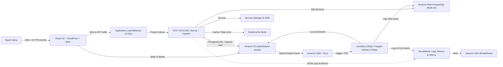

# ☁️ Kiến trúc Đám mây AWS Toàn diện — UteTechStore & Hệ thống Thumbnail/Watermark

> **Vị trí tài liệu:** `docs/CLOUD_ARCHITECTURE_AWS.md`  
> **Trạng thái:** Đã chuẩn hóa & thống nhất kiến trúc cho **UteTechStore** (`Next.js 14` + `FastAPI` + `PostgreSQL` + `S3/SQS/Lambda Thumbnail & Watermark`)  
> **Region chính:** `ap-southeast-1` (Singapore) — Triển khai trên **2 Availability Zones (`ap-southeast-1a`, `ap-southeast-1b`)**

---

## 1. Thống nhất Các Quyết định Kiến trúc (Architecture Decisions)

Để đảm bảo sự đồng nhất tuyệt đối giữa báo cáo thiết kế và mã nguồn thực tế, toàn bộ hệ thống chốt **4 quyết định kiến trúc** sau:

1. **Thống nhất Cơ chế Hàng đợi & Xử lý Bất đồng bộ:**
   - **Lựa chọn:** `Amazon S3 (raw/)` $\rightarrow$ `S3 Event Notification` $\rightarrow$ **`Amazon SQS` (kèm Dead Letter Queue - DLQ)** $\rightarrow$ `AWS Lambda` *(hoặc `ECS Fargate Worker` nếu file PDF quá lớn)*.
   - **Lý do:** Mô hình `S3 → SQS → Worker` tách rời hoàn toàn lưu trữ và xử lý, hỗ trợ **Retry tự động**, chống mất sự kiện qua **DLQ**, kiểm soát được tốc độ xử lý đồng thời (Concurrency) và dễ dàng đạt tính **Idempotency** (chống xử lý trùng).
2. **Thống nhất Cơ sở dữ liệu (Local ↔ AWS):**
   - **Lựa chọn:** **SQLite (`titan_silicon.db`)** ở Local Dev và **Amazon RDS PostgreSQL 16** trên Docker / AWS Cloud (dùng chung tầng `SQLAlchemy` trong `apps/api/models/entities.py`).
   - **Lý do:** Không dùng DynamoDB để tránh phân mảnh giữa SQL và NoSQL; giữ nguyên 1 schema quan hệ (`products`, `categories`, `orders`, `documents`) và chuyển đổi chỉ bằng 1 biến `DATABASE_URL`.
3. **Thống nhất Cổng API & Bảo vệ truy cập (API Exposure):**
   - **Lựa chọn:** `Route 53 (DNS)` $\rightarrow$ `Amazon CloudFront (HTTPS/ACM + AWS WAF)` $\rightarrow$ `Application Load Balancer (ALB)` $\rightarrow$ `Next.js (:3000)` & `FastAPI (:8000)`.
   - **Lý do:** Không dùng API Gateway gọi thẳng Lambda cho các nghiệp vụ Web. Mọi API đều đi qua **FastAPI** để dùng chung xác thực, `ApiResponse`, `MetaPagination` và sinh **S3 Presigned URL** cho client upload trực tiếp lên S3.
4. **Giải pháp cho Rủi ro Xử lý Ảnh & PDF Lớn:**
   - Với ảnh sản phẩm và PDF Catalogue/Datasheet thông thường, **AWS Lambda** (timeout `15 phút`, RAM `2048 MB`, `/tmp` `2048 MB`) xử lý nhanh trong vài giây.
   - **Phương án Hybrid dự phòng:** Nếu người dùng upload file PDF dung lượng lớn (`> 50MB` hoặc `> 200 trang`), FastAPI định tuyến job sang **SQS Large-Job Queue** để **ECS Fargate Worker** (không bị giới hạn 15 phút của Lambda) xử lý.

---

## 2. Sơ đồ Kiến trúc Tổng thể (Cloud-Native Unified Architecture)

---

## 3. Mức A — Thiết kế Hạ tầng Cốt lõi & Bảo mật Bắt buộc

### 3.1. VPC, Subnets, Route Tables & Gateways (`10.0.0.0/16`)

| Thành phần | CIDR / Phạm vi | AZ | Route Table chính |
| :--- | :--- | :--- | :--- |
| **Public Subnet 1 & 2** | `10.0.1.0/24`, `10.0.2.0/24` | `1a`, `1b` | `0.0.0.0/0` $\rightarrow$ **Internet Gateway (IGW)** (chứa ALB, NAT Gateway) |
| **Private App Subnet 1 & 2** | `10.0.11.0/24`, `10.0.12.0/24` | `1a`, `1b` | `0.0.0.0/0` $\rightarrow$ **NAT Gateway**; S3 $\rightarrow$ **S3 Gateway Endpoint** |
| **Private DB Subnet 1 & 2** | `10.0.21.0/24`, `10.0.22.0/24` | `1a`, `1b` | Chỉ nội bộ `10.0.0.0/16` (Local), không có đường ra Internet |
| **VPC Endpoints** | Gateway & Interface | VPC | **S3 Gateway Endpoint** (miễn phí, lưu lượng S3 không đi qua NAT), **Secrets Manager / CloudWatch Interface Endpoint** |

### 3.2. Security Groups (Inbound & Outbound Rules)

| Security Group | Inbound (Cổng & Nguồn) | Outbound (Cổng & Đích) |
| :--- | :--- | :--- |
| **ALB-SG** | `443 (HTTPS)` từ `0.0.0.0/0` (hoặc CloudFront Prefix List); `80` redirect `443` | `3000`, `8000` $\rightarrow$ `App-SG` |
| **App-SG** (EC2/ECS) | `3000 (Next.js)`, `8000 (FastAPI)` từ `ALB-SG` | `5432` $\rightarrow$ `DB-SG`; `6379` $\rightarrow$ `DB-SG`; `443` $\rightarrow$ `0.0.0.0/0` (S3/Secrets) |
| **Worker-SG** (Lambda/Fargate) | Không mở Inbound | `5432` $\rightarrow$ `DB-SG`; `443` $\rightarrow$ `0.0.0.0/0` (S3/SQS/Logs) |
| **DB-SG** (RDS & Redis) | `5432 (PostgreSQL)`, `6379 (Redis)` từ `App-SG` và `Worker-SG` | Không mở Outbound ra ngoài |

### 3.3. IAM Roles (Least Privilege — Không Hardcode Key)
1. **IAM Role cho FastAPI Backend (`UteTechStore-Api-Role`):**
   - `s3:PutObject` chỉ trên `arn:aws:s3:::utetechstore-assets/raw/*`.
   - `s3:GetObject` trên `arn:aws:s3:::utetechstore-assets/processed/*`.
   - `secretsmanager:GetSecretValue` chỉ trên ARN secret của `utetechstore/prod/*`.
   - `logs:CreateLogStream`, `logs:PutLogEvents` trên Log Group `/utetechstore/api`.
2. **IAM Role cho Lambda / Worker (`UteTechStore-Worker-Role`):**
   - `sqs:ReceiveMessage`, `sqs:DeleteMessage`, `sqs:GetQueueAttributes` trên `utetechstore-pdf-queue`.
   - `s3:GetObject` chỉ trên `raw/*` và `assets/*`.
   - `s3:PutObject` chỉ trên `processed/*`.
   - `ec2:CreateNetworkInterface` (AWSLambdaVPCAccessExecutionRole) để kết nối RDS trong Private Subnet.

### 3.4. Bảo mật & Vòng đời Amazon S3 (`utetechstore-assets`)
- **Block Public Access:** Bật **ON toàn bộ 4 tùy chọn** (không bao giờ mở public bucket).
- **Bucket Policy:** Chỉ cho phép **CloudFront Origin Access Control (OAC)** đọc `processed/*` và các IAM Role nội bộ thao tác theo prefix; từ chối mọi kết nối không dùng HTTPS (`aws:SecureTransport == false`).
- **Encryption & Versioning:** Bật mã hóa mặc định **SSE-S3 (AES-256)** (hoặc SSE-KMS) và bật **Versioning** để khôi phục khi ghi đè nhầm.
- **Lifecycle Policy:**
  - Chuyển `raw/*` sang **S3 Standard-IA** sau 30 ngày, sang **Glacier Instant Retrieval** sau 90 ngày.
  - Tự động xóa **Incomplete Multipart Uploads** sau 7 ngày để tránh lãng phí dung lượng.

### 3.5. Hàng đợi Amazon SQS & Dead Letter Queue (DLQ)
- **Main Queue:** `utetechstore-pdf-queue` (Standard Queue), `VisibilityTimeout = 900 giây` (bằng max timeout Lambda), `MessageRetentionPeriod = 4 ngày`.
- **Dead Letter Queue (DLQ):** `utetechstore-pdf-dlq` với `maxReceiveCount = 3` (nếu xử lý lỗi 3 lần do PDF hỏng/mã hóa mật khẩu, message tự chuyển sang DLQ để không lặp vô hạn và kích hoạt CloudWatch Alarm).

### 3.6. Thiết kế Database (`PostgreSQL RDS` / `SQLite`) & Quản lý Trạng thái
- Thống nhất bảng `documents` trong `apps/api/models/entities.py` (`SlideDocument`):
  - **PK:** `doc_id` (`VARCHAR(64)`).
  - **Indexes:** `idx_documents_status (status)`, `idx_documents_created_at (created_at DESC)`, `idx_documents_etag (s3_etag)`.
  - **Cập nhật trạng thái an toàn (Atomic Transition):** Worker cập nhật `UPDATE documents SET status = 'PROCESSING' WHERE doc_id = :id AND status IN ('PENDING', 'FAILED')` trước khi chạy, tránh 2 worker xử lý song song cùng 1 file.

### 3.7. API Exposure, Xác thực & Secrets Management
- **Endpoints chuẩn hóa (`/api/v1/documents`):**
  - `POST /api/v1/documents/presigned-upload` (cấp Presigned URL upload thẳng S3 `raw/`, giới hạn kích thước `<= 50MB`, `Content-Type: application/pdf` hoặc ảnh).
  - `GET /api/v1/documents` (tìm kiếm + phân trang `MetaPagination`), `GET /api/v1/documents/{doc_id}`, `POST /api/v1/documents/{doc_id}/reprocess`.
- **Authentication & Authorization:** Dùng JWT (`JWT_SECRET` trong `apps/api/core/config.py`) phân biệt quyền `USER` (xem/tải tài liệu) và `ADMIN` (upload, cấu hình watermark, reprocess).
- **CORS & Rate Limiting:** Khóa `allow_origins` về domain CloudFront chính thức (thay cho `*` ở Production); giới hạn tần suất qua **AWS WAF** + **Redis**.
- **Secrets Management:** Lưu `DATABASE_URL`, `JWT_SECRET`, thông tin RDS trong **AWS Secrets Manager** (bật Auto-rotation); lưu cấu hình không nhạy cảm (`AWS_S3_BUCKET`, `CLOUDFRONT_DOMAIN`, `SQS_QUEUE_URL`) trong **SSM Parameter Store**.

---

## 4. Mức B — Độ tin cậy, Mở rộng & Khả năng Vận hành

| Thành phần | Phương án triển khai cụ thể |
| :--- | :--- |
| **High Availability (Multi-AZ)** | ALB chạy trên 2 AZ; EC2/ECS Auto Scaling trải đều 2 AZ; **RDS PostgreSQL Multi-AZ** tự động failover sang Standby trong `< 60 giây`; Redis Replication Group; S3 lưu trữ phân tán $\ge$ 3 AZs (độ bền `11 số 9`). |
| **Auto Scaling** | **Tầng Web/API:** EC2/ECS ASG scale `1 -> 4` instances khi CPU > `70%`. **Tầng Worker:** Lambda tự co giãn concurrency (đặt **Reserved Concurrency = 20** để không làm quá tải DB RDS); ECS Fargate Worker scale theo metric `ApproximateNumberOfMessagesVisible` của SQS. |
| **Monitoring & Alerting** | FastAPI xuất **Structured JSON Logs** (`timestamp`, `level`, `request_id`, `path`, `latency_ms`) về **CloudWatch Logs**. Tạo Dashboard theo dõi Latency, Error Rate, SQS Queue Depth. Cấu hình **CloudWatch Alarm** bắn cảnh báo qua **Amazon SNS (Email)** khi: `DLQ Messages > 0`, `HTTP 5xx > 5 trong 5 phút`, hoặc `RDS CPU > 80%`. |
| **Retry & Idempotency** | Kết hợp `(doc_id, s3_etag)` làm **Idempotency Key**. Khi Lambda/Worker nhận message từ SQS, kiểm tra nếu `status == 'COMPLETED'` và `s3_etag` trùng khớp thì bỏ qua ngay (`ack` SQS), đảm bảo S3 gửi lại event cũng không tạo trùng bản ghi hay ghi đè sai. |
| **Backup, Recovery & DR** | • **Database:** Bật RDS Automated Backups (lưu 7 ngày) + Point-in-Time Recovery (PITR). • **S3:** Bật S3 Versioning để phục hồi file tức thì. • **Mục tiêu khôi phục:** **RTO $\le$ 15 phút** (khởi tạo lại EC2/ECS từ Docker Image + Terraform), **RPO $\le$ 5 phút** (dựa trên RDS PITR Transaction Logs & S3 Versioning). |
| **Performance & Benchmark** | Kiểm thử tải đồng thời các job upload ảnh/PDF qua SQS: giới hạn bộ nhớ Lambda `2048 MB`, xóa file tạm trong `/tmp` ngay sau mỗi job (`finally` block) để tái sử dụng container ấm (warm start) không bị đầy `/tmp`. |

---

## 5. Mức C — Triển khai Tự động, Bảo vệ & Dự toán Chi phí

### 5.1. Infrastructure as Code (IaC) & Quy trình Môi trường
- **IaC (`infra/terraform/` hoặc `template.yaml` AWS SAM):** Khai báo toàn bộ VPC, Subnets, Security Groups, IAM Roles, S3, SQS+DLQ, RDS, Lambda bằng code để dựng/xóa hạ tầng đồng nhất qua 3 môi trường:
  - **Dev:** Chạy trên máy cá nhân với `docker-compose.yml` (`postgres`, `redis`, `localstack`, `api`, `web`).
  - **Staging:** AWS Single-AZ (`t3.micro`, `db.t3.micro`) để kiểm thử tích hợp thực tế trước khi phát hành.
  - **Production:** AWS Multi-AZ bật đầy đủ WAF, CloudFront, Auto Scaling và CloudWatch Alarms.

### 5.2. CI/CD Pipeline (`.github/workflows/ci-cd.yml`)
1. **Trigger:** Push / Merge PR vào `main`.
2. **Test & Build:** Chạy `pytest` (FastAPI), `npm run build` (Next.js), kiểm tra định dạng Lambda.
3. **Package & Push:** Build Docker Image cho `api` và `web`, đẩy lên **Amazon ECR**; đóng gói Lambda zip/layer.
4. **Deploy:** Cập nhật ECS/EC2 Service & AWS Lambda Function, chạy smoke test `GET /health`.

### 5.3. Domain, HTTPS & Bảo vệ WAF
- **DNS & SSL:** Quản lý tên miền trên **Amazon Route 53**, cấp chứng chỉ TLS 1.3 miễn phí từ **AWS Certificate Manager (ACM)** gắn lên CloudFront & ALB.
- **AWS WAF:** Gắn Web ACL lên CloudFront với:
  - `AWSManagedRulesCommonRuleSet` & `AWSManagedRulesSQLiRuleSet` (chống XSS, SQL Injection).
  - **Rate-based Rule:** Chặn IP gửi quá `1.000 requests / 5 phút` để chống DDoS / spam API upload & tìm kiếm.

### 5.4. Dự toán Chi phí Chi tiết Theo Quy mô Sử dụng (Region Singapore)

| Quy mô | Số lượng PDF & Trang | Dung lượng S3 (`raw` + `processed`) | Lưu lượng Lambda / SQS | Chi phí ước tính / tháng |
| :--- | :--- | :--- | :--- | :---: |
| **Mức 1: Đồ án / Demo (Free Tier)** | 10–50 files tài liệu/ảnh sản phẩm | ~0.5 GB | < 5.000 requests, < 2 GB CloudFront | **\$0 – \$2** *(nếu dùng Free Tier EC2/RDS `t3.micro`)* |
| **Mức 2: Vận hành thực tế nhỏ** | 500 files (~25.000 trang/tháng) | ~10 GB (có Lifecycle IA) | ~50.000 SQS/Lambda req, 20 GB CloudFront | **~\$35 – \$55 / tháng** *(EC2 `t3.small` + RDS `db.t3.micro`)* |
| **Mức 3: Quy mô Production Multi-AZ** | 5.000+ files (~250.000 trang/tháng) | ~100 GB | ~500.000 req, 150 GB CloudFront + ALB + NAT | **~\$160 – \$220 / tháng** |

---

## 6. Bảng Đối chiếu Đáp ứng Toàn bộ Kiến thức Môn học (10 Modules Checklist)

Bảng dưới đây dùng để kiểm chứng kiến trúc **UteTechStore** đã bao phủ đầy đủ các từ khóa và khái niệm trọng tâm trong 10 bài học của môn học:

| Bài học (Module) | Nội dung / Keyword trọng tâm | Đã ứng dụng vào đồ án `UteTechStore` |
| :--- | :--- | :--- |
| **Module 1** | Cloud Concepts (On-demand, Elasticity, Pay-as-you-go) | Tách lớp Web/API, Storage, Worker độc lập để co giãn theo tải |
| **Module 2** | Cloud Economics, TCO, Pricing Calculator | Bảng dự toán chi phí 3 mức + Lifecycle S3 + tận dụng Free Tier |
| **Module 3** | Global Infrastructure (Region, AZ, Edge Location) | Region `ap-southeast-1`, Multi-AZ (`1a`/`1b`), CloudFront Edge |
| **Module 4** | Cloud Security (IAM Least Privilege, Security Groups, Secrets) | IAM Roles theo prefix S3, Security Groups 3 lớp, Secrets Manager |
| **Module 5** | Networking & Content Delivery (VPC, Subnets, NAT, CloudFront, Route 53) | VPC `10.0.0.0/16` Public/Private, S3 Gateway Endpoint, Route 53 + ACM |
| **Module 6** | Compute (EC2, ECS/Fargate, AWS Lambda) | EC2/ECS chạy Next.js & FastAPI; Lambda/Fargate xử lý Thumbnail/Watermark |
| **Module 7** | Storage (Amazon S3, Encryption, Versioning, Lifecycle) | S3 `utetechstore-assets` (`raw/`, `processed/`), Block Public Access, SSE-S3 |
| **Module 8** | Databases (Amazon RDS PostgreSQL, ElastiCache Redis) | RDS PostgreSQL Multi-AZ (chuyển từ SQLite qua `DATABASE_URL`) + Redis |
| **Module 9** | Cloud Architecture (Well-Architected Framework, Decoupling, DR) | Mô hình `S3 -> SQS (DLQ) -> Worker`, Idempotency, RTO/RPO |
| **Module 10** | Automatic Scaling & Monitoring (ALB, ASG, CloudWatch, SNS) | ALB Health Check, ASG CPU > 70%, CloudWatch JSON Logs + SNS Alert |
