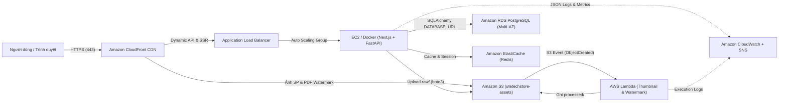

# ☁️ Kiến trúc Đám mây AWS & Hạ tầng Triển khai — UteTechStore

> **Vị trí tài liệu:** `docs/CLOUD_ARCHITECTURE_AWS.md`  
> **Phạm vi áp dụng:** Toàn bộ đồ án Web **UteTechStore** (`Next.js 14` + `FastAPI` + `PostgreSQL` + `S3/Lambda Thumbnail & Watermark`)  
> **Phụ trách triển khai:** Cloud Team (**Ngọc Huy** & **Trọng Sơn**) phối hợp cùng Web Team (**Huỳnh Hương** & **Đăng Khoa**)

---

## 1. Tổng quan Kiến trúc Cloud (AWS Academy Modules 1, 3, 9)

Hệ thống **UteTechStore** được thiết kế theo kiến trúc **Cloud-Native tách lớp (Decoupled + Event-Driven)**, tuân thủ **5 trụ cột AWS Well-Architected Framework** (Operational Excellence, Security, Reliability, Performance Efficiency, Cost Optimization).

- **Region triển khai chính:** `ap-southeast-1` (Singapore) — tối ưu độ trễ cho người dùng tại Việt Nam.
- **Tính sẵn sàng cao (High Availability):** Triển khai trên **2 Availability Zones (AZ-a & AZ-b)** cho tầng Web/API, Load Balancer và Database.



---

## 2. Thiết kế Mạng VPC & Phân phối Nội dung (Module 5)

### 2.1. Cấu trúc VPC (`10.0.0.0/16`)
| Thành phần | Subnet CIDR | Availability Zone | Thành phần đặt bên trong |
| :--- | :--- | :--- | :--- |
| **Public Subnet 1** | `10.0.1.0/24` | `ap-southeast-1a` | Application Load Balancer (ALB), NAT Gateway |
| **Public Subnet 2** | `10.0.2.0/24` | `ap-southeast-1b` | Application Load Balancer (ALB) dự phòng |
| **Private App Subnet 1** | `10.0.11.0/24` | `ap-southeast-1a` | EC2 / Docker (`utetechstore-web`, `utetechstore-api`) |
| **Private App Subnet 2** | `10.0.12.0/24` | `ap-southeast-1b` | EC2 / Docker (Auto Scaling Instance) |
| **Private DB Subnet 1 & 2** | `10.0.21.0/24`, `10.0.22.0/24` | `ap-southeast-1a`, `1b` | Amazon RDS PostgreSQL, ElastiCache Redis |

### 2.2. Amazon CloudFront (CDN)
- Cache toàn bộ file tĩnh của Next.js (`_next/static/*`) và tài nguyên media từ S3 Bucket `utetechstore-assets/processed/*`.
- Giúp giảm tải trực tiếp cho EC2 và rút ngắn thời gian tải ảnh sản phẩm / Thumbnail 16:9.

---

## 3. Bảo mật Đám mây — IAM & Security Groups (Module 4)

### 3.1. Nguyên tắc IAM Least Privilege (Không dùng Access Key cứng)
- Gắn **IAM Instance Profile Role** trực tiếp cho EC2 (FastAPI Backend) và **IAM Execution Role** cho AWS Lambda.
- Quyền tối thiểu chỉ cho phép thao tác trên đúng bucket `utetechstore-assets`:

```json
{
  "Version": "2012-10-17",
  "Statement": [
    {
      "Effect": "Allow",
      "Action": ["s3:PutObject", "s3:GetObject", "s3:DeleteObject", "s3:ListBucket"],
      "Resource": [
        "arn:aws:s3:::utetechstore-assets",
        "arn:aws:s3:::utetechstore-assets/*"
      ]
    }
  ]
}
```

### 3.2. Ma trận Security Groups (Stateful Firewall)
| Security Group | Inbound (Cho phép vào) | Nguồn (Source) | Mục đích |
| :--- | :--- | :--- | :--- |
| **ALB-SG** | `80 (HTTP)`, `443 (HTTPS)` | `0.0.0.0/0` | Tiếp nhận traffic từ người dùng / CloudFront |
| **App-SG** | `3000 (Next.js)`, `8000 (FastAPI)` | `ALB-SG` | Chỉ nhận request đi qua Load Balancer |
| **DB-SG** | `5432 (PostgreSQL)`, `6379 (Redis)` | `App-SG` | Cô lập hoàn toàn Database khỏi Internet |

---

## 4. Điện toán & Xử lý Phi máy chủ (Module 6)

### 4.1. Tầng Ứng dụng (EC2 + Docker Compose)
- Sử dụng `docker-compose.yml` để chạy đồng nhất giữa Local và EC2 gồm các container: `utetechstore-web` (`:3000`), `utetechstore-api` (`:8000`), `utetechstore-postgres` (`:5432`), `utetechstore-redis` (`:6379`) và `utetechstore-localstack` (`:4566` khi chạy Local).

### 4.2. Tầng Serverless Event-Driven (`cloud/lambda_watermark/handler.py`)
- **Cơ chế kích hoạt:** S3 Event Notification (`s3:ObjectCreated:*`) trên prefix `raw/`.
- **Nhiệm vụ xử lý tự động:**
  1. Đọc file ảnh sản phẩm hoặc PDF tài liệu/catalogue từ `raw/`.
  2. Dùng `PyMuPDF` (`fitz`) + `Pillow` render trang bìa (hỗ trợ chọn trang 1 hoặc trang 2 đối với file đặc biệt) thành 3 kích thước Thumbnail chuẩn 16:9 (`320×180`, `640×360`, `1280×720`).
  3. Đóng dấu **Watermark `UteTechStore`** lên ảnh Thumbnail và toàn bộ trang PDF (giữ nguyên text tìm kiếm được — searchable text).
  4. Lưu kết quả vào `processed/thumbnails/` và `processed/watermarked_pdfs/` (tuyệt đối không ghi đè file gốc ở `raw/`).

---

## 5. Lưu trữ & Cơ sở dữ liệu (Module 7 & 8)

| Thành phần | Giải pháp Local / Dev | Giải pháp AWS Cloud | Điểm kết nối trong Code |
| :--- | :--- | :--- | :--- |
| **Object Storage** | LocalStack S3 (`:4566`) | Amazon S3 (`utetechstore-assets`) | `apps/api/services/s3_service.py` (`boto3`) |
| **Relational DB** | SQLite (`titan_silicon.db`) / Docker Postgres | Amazon RDS PostgreSQL 16 (Multi-AZ) | Biến `DATABASE_URL` trong `.env` & `apps/api/core/config.py` |
| **In-Memory Cache** | Docker Redis (`:6379`) | Amazon ElastiCache for Redis | Biến `REDIS_URL` trong `.env` |

---

## 6. Cân bằng tải, Auto Scaling & Giám sát (Module 10)

1. **Application Load Balancer (ALB):**
   - Định tuyến `/` $\rightarrow$ Target Group `Next.js (:3000)` và `/api/*` $\rightarrow$ Target Group `FastAPI (:8000)`.
   - Health check định kỳ gọi `GET /health` trên FastAPI (kiểm tra cả kết nối Database lẫn S3).
2. **Auto Scaling Group (ASG):**
   - Min: `1` instance | Desired: `2` instances | Max: `4` instances.
   - Target Tracking Policy: Tự động tăng instance khi CPU trung bình > `70%`.
3. **Amazon CloudWatch + SNS:**
   - Thu thập **Structured JSON Logs** từ `apps/api/main.py` và log thực thi của AWS Lambda.
   - Thiết lập **CloudWatch Alarm**: gửi cảnh báo email qua **Amazon SNS** khi tỷ lệ lỗi HTTP `5xx` > `5` trong 5 phút hoặc CPU RDS > `80%`.

---

## 7. Dự toán Chi phí Vận hành (Module 2 — AWS Economics)

Ước tính cho môi trường **Demo / Đồ án (AWS Free Tier & Learner Lab)** trong 1 tháng:

| Dịch vụ AWS | Cấu hình dự kiến | Chi phí ước tính / tháng |
| :--- | :--- | :---: |
| **Amazon EC2** | `t3.small` / `t2.micro` (Free Tier 750h/tháng) | `\$0 – \$15` |
| **Amazon RDS (PostgreSQL)** | `db.t3.micro` (20GB gp3, Free Tier 750h/tháng) | `\$0 – \$13` |
| **Amazon S3 + CloudFront** | 5GB lưu trữ, 10.000 requests, 10GB băng thông | `\$0 – \$1` |
| **AWS Lambda** | 10.000 lần xử lý Thumbnail/Watermark (Free Tier 1M req) | `\$0` |
| **CloudWatch & SNS** | Basic metrics + log < 5GB | `\$0` |
| **Tổng cộng (tối ưu Free Tier)** | **Phù hợp sinh viên & chạy đồ án thực tế** | **~\$0 – \$29 / tháng** |

---

## 8. Tiêu chí Nghiệm thu Chung cho Phần Cloud

1. **Môi trường LocalStack (`docker compose up -d`):** Khởi chạy đủ 5 container (`postgres`, `redis`, `localstack`, `api`, `web`), tự động tạo bucket `utetechstore-assets` và gắn trigger Lambda.
2. **Luồng Event-Driven thực tế:** Upload 1 ảnh hoặc file PDF vào `raw/` $\rightarrow$ Lambda tự động chạy và xuất ra đủ 3 kích thước Thumbnail (`sm`, `md`, `lg`) + PDF có watermark trong `processed/`.
3. **Kiểm tra sức khỏe hệ thống:** `GET /health` trả về `HEALTHY` kèm trạng thái kết nối thành công tới cả **Database** và **S3**.
4. **Hồ sơ triển khai AWS:** Đầy đủ bằng chứng cấu hình IAM Role, Security Group, RDS, CloudWatch Log/Alarm và tài liệu này để phục vụ bảo vệ đồ án.
