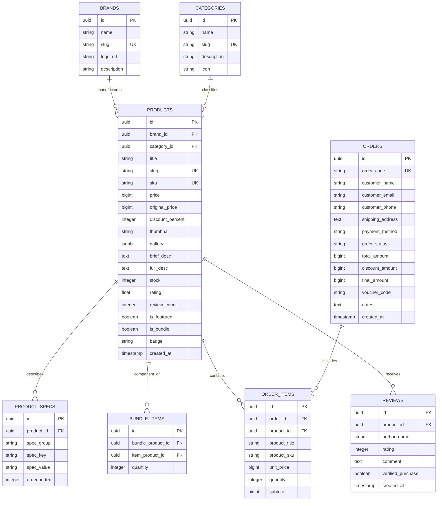

# ERD.md — Database Design & Schema Specification

> **Hệ quản trị CSDL:** PostgreSQL 16 (có hỗ trợ SQLite in-memory / local fallback)  
> **ORM Framework:** SQLAlchemy 2.0 (Python)

---

## 1. Sơ Đồ Thực Thể Liên Kết (Entity-Relationship Diagram)

---

## 2. Chi Tiết Các Bảng Dữ Liệu (Schema Dictionary)

### 2.1. Bảng `brands`
* `id` (UUID, Primary Key): Định danh duy nhất của thương hiệu.
* `name` (VARCHAR(100)): Tên thương hiệu (`Apple`, `NVIDIA`, `Titan Studio`).
* `slug` (VARCHAR(100), Unique): Đường dẫn URL thân thiện (`apple`, `nvidia`, `titan-synergy`).
* `logo_url` (VARCHAR(500)): Đường dẫn ảnh logo vector/PNG.
* `description` (TEXT): Giới thiệu ngắn về thương hiệu.

### 2.2. Bảng `categories`
* `id` (UUID, Primary Key): Định danh danh mục.
* `name` (VARCHAR(100)): Tên danh mục (ví dụ: `iPhone Flagships`, `NVIDIA GeForce GPUs`, `AI Workstations & Jetson`, `Synergy Bundles`, `Phụ Kiện Cao Cấp`).
* `slug` (VARCHAR(100), Unique): Slug danh mục.
* `icon` (VARCHAR(50)): Mã biểu tượng Lucide tương ứng.

### 2.3. Bảng `products`
* `id` (UUID, Primary Key): Mã sản phẩm.
* `brand_id` (UUID, Foreign Key -> `brands.id`): Thương hiệu sở hữu.
* `category_id` (UUID, Foreign Key -> `categories.id`): Phân loại sản phẩm.
* `title` (VARCHAR(255)): Tên thương mại sản phẩm.
* `slug` (VARCHAR(255), Unique): Đường dẫn SEO.
* `sku` (VARCHAR(64), Unique): Mã quản lý kho hàng (VD: `IPHONE-16PM-512-TI`, `NV-RTX5090-32G-FE`).
* `price` (BIGINT): Giá bán hiện tại (đơn vị VNĐ, VD: `34990000`).
* `original_price` (BIGINT): Giá niêm yết gốc trước khi giảm.
* `discount_percent` (INTEGER): Tỉ lệ giảm giá (%).
* `thumbnail` (VARCHAR(500)): Ảnh đại diện chính.
* `gallery` (JSONB): Danh sách URL các góc chụp chi tiết.
* `brief_desc` (TEXT): Tóm tắt tính năng nổi bật (gạch đầu dòng).
* `full_desc` (TEXT): Bài viết đánh giá chi tiết định dạng Markdown/HTML.
* `stock` (INTEGER): Tồn kho khả dụng.
* `rating` (FLOAT): Điểm đánh giá trung bình (1.0 - 5.0).
* `review_count` (INTEGER): Tổng số lượt đánh giá.
* `is_featured` (BOOLEAN): Sản phẩm nổi bật ghim trang chủ.
* `is_bundle` (BOOLEAN): Đánh dấu combo tích hợp iPhone + NVIDIA.
* `badge` (VARCHAR(50)): Huy hiệu hiển thị (VD: `Mới ra mắt`, `Bán chạy`, `Siêu chip AI`).
* `created_at` (TIMESTAMP): Thời gian tạo.

### 2.4. Bảng `product_specs`
* `id` (UUID, Primary Key): Định danh thông số.
* `product_id` (UUID, Foreign Key -> `products.id` ON DELETE CASCADE).
* `spec_group` (VARCHAR(100)): Nhóm thông số (VD: `Hiệu năng & Vi xử lý`, `Bộ nhớ & Đồ họa`, `Màn hình`, `Kết nối`).
* `spec_key` (VARCHAR(100)): Tên thông số (VD: `Chip xử lý`, `Số nhân CUDA`, `VRAM`, `Công nghệ AI`).
* `spec_value` (VARCHAR(255)): Giá trị chi tiết (VD: `A18 Pro (3nm)`, `16,384 CUDA Cores`, `24GB GDDR6X`, `DLSS 3.5 & Tensor G5`).
* `order_index` (INTEGER): Thứ tự hiển thị.

### 2.5. Bảng `orders` & `order_items`
* Quản lý toàn bộ giao dịch đặt hàng, mã vận đơn tự động định dạng `ORD-YYYY-XXXXX`, kiểm soát trạng thái giao hàng: `PENDING`, `PROCESSING`, `SHIPPED`, `DELIVERED`, `CANCELLED`.
